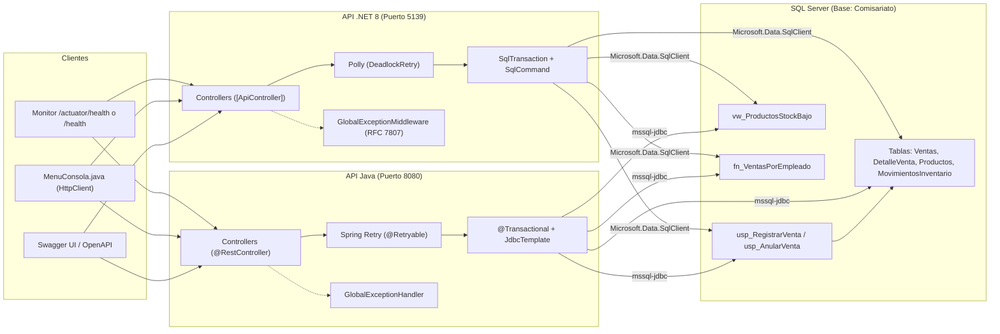
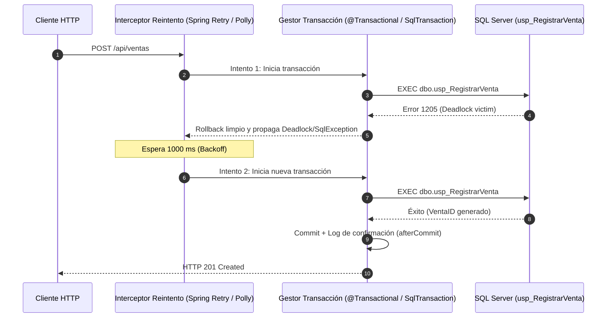

# Informe Técnico: Arquitectura e Implementación de Servicios REST para Comisariato (Java y .NET)

**Autores:** Daniel Zambrano, Javier Artiles  
**Fecha:** 24 de noviembre de 2026  
**Repositorio:** [https://github.com/danieluuu1/Actividad-Java-y-.NET](https://github.com/danieluuu1/Actividad-Java-y-.NET)  
**Versión en PDF:** [Informe_Tecnico_Comisariato_Java_y_NET.pdf](./Informe_Tecnico_Comisariato_Java_y_NET.pdf)

---

## 1. Resumen Ejecutivo

El presente informe técnico documenta el diseño, arquitectura, integración con base de datos y mecanismos de resiliencia de dos implementaciones paralelas de servicios REST para el sistema transaccional **Comisariato** sobre **Microsoft SQL Server**:

1. **`comisariato-java/`**: Servicio implementado con **Java 17+**, **Spring Boot 3.5.8**, **Spring JDBC (`JdbcTemplate`)**, **Spring Retry** y **springdoc-openapi**, acompañado de scripts SQL de provisión, un rol de privilegios mínimos y un cliente HTTP interactivo en consola ([`MenuConsola.java`](./comisariato-java/java-api/src/main/java/edu/comisariato/api/menu/MenuConsola.java)).
2. **`dotnet-api/`**: Servicio implementado con **.NET 8 (ASP.NET Core 8 Web API)**, **ADO.NET (`Microsoft.Data.SqlClient`)**, **Polly** y **Swashbuckle (Swagger)**.

Ambas soluciones prescinden deliberadamente de mapeadores objeto-relacionales (ORM como Hibernate/JPA o Entity Framework Core) para garantizar control explícito sobre las transacciones, el paso de parámetros y la ejecución directa de procedimientos almacenados, vistas y funciones de tabla en SQL Server.

---

## 2. Objetivos y Alcance

- **Integración Transaccional:** Exponer cinco operaciones de negocio críticas (registro de venta, anulación de venta, consulta de stock bajo, consulta de ventas por empleado y trazabilidad de movimientos de inventario) delegando el cálculo financiero y la atomicidad al motor relacional.
- **Comparabilidad Arquitectónica:** Contrastar dos ecosistemas empresariales (JVM/Spring vs. CLR/.NET) resolviendo exactamente los mismos retos de concurrencia, validación de entrada, traducción de errores SQL y observabilidad.
- **Seguridad y Mínimo Privilegio:** Evitar credenciales hardcodeadas en el código fuente, parametrizar todas las consultas contra inyección SQL y restringir permisos mediante roles dedicados en base de datos.

---

## 3. Estructura del Repositorio

```text
Actividad-Java-y-.NET/
├── README.md                                       # Este informe técnico (documento principal)
├── Informe_Tecnico_Comisariato_Java_y_NET.pdf      # Versión compilada en PDF
├── global.json                                     # Fijación de versión .NET SDK (8.0.428)
├── .gitignore                                      # Reglas de exclusión de compilación y secretos
│
├── dotnet-api/                                     # Implementación ASP.NET Core 8
│   ├── Comisariato.Api.csproj                      # Dependencias: SqlClient 5.2.2, Polly 8.4.2, Swashbuckle 6.6.2
│   ├── Program.cs                                  # Contenedor DI, Swagger, HealthChecks y middleware
│   ├── Controllers/                                # VentasController, ProductosController, EmpleadosController
│   ├── Services/                                   # IVentaService, IProductoService y manejo transaccional
│   ├── Repositories/                               # IVentaRepository, IProductoRepository (ADO.NET puro)
│   ├── DTOs/                                       # Records C# inmutables con DataAnnotations
│   ├── Infrastructure/                             # PollyPolicies, SqlExceptionTranslator, GlobalExceptionMiddleware
│   └── appsettings.example.json                    # Plantilla de cadena de conexión
│
└── comisariato-java/                               # Implementación Java Spring Boot 3
    ├── java-api/                                   # Proyecto Maven (Java 17 bytecode, Spring Boot 3.5.8)
    │   ├── pom.xml                                 # Dependencias: spring-jdbc, mssql-jdbc, spring-retry, springdoc
    │   └── src/
    │       ├── main/java/edu/comisariato/api/      # controller, service, repository, dto, exception, config, menu
    │       ├── main/resources/application.yml      # Configuración externalizada por variables de entorno
    │       └── test/java/edu/comisariato/api/      # Pruebas de contrato, traducción SQL, reintento e integración
    ├── database/                                   # Scripts SQL Server ordenados
    │   ├── 01_base_original.sql                    # Esquema base y datos semilla
    │   ├── 02_objetos_api.sql                      # ConfiguracionFacturacion, SPs, vista y función
    │   └── 03_rol_aplicacion.sql                   # Rol de mínimos privilegios comisariato_app
    ├── docs/                                       # Documentación técnica, evidencias y OpenAPI JSON
    ├── native/                                     # DLL mssql-jdbc_auth-13.2.1.x64.dll (Windows Auth local)
    └── scripts/                                    # Automatización PowerShell (instalación, ejecución y menú)
```

---

## 4. Arquitectura del Sistema

Ambas APIs adoptan una arquitectura por capas estricta (**Controller → Service → Repository → Base de Datos**), separando la validación de transporte HTTP, la orquestación de transacciones y reintentos, y la interacción SQL de bajo nivel.



---

## 5. Comparativa Técnica: Java vs. .NET 8

| Característica | Implementación Java (`comisariato-java/`) | Implementación .NET (`dotnet-api/`) |
| :--- | :--- | :--- |
| **Runtime y Lenguaje** | Java 17 LTS (compilado con JDK 21) | .NET 8.0 (SDK `8.0.428` en `global.json`) |
| **Framework Web** | Spring Boot `3.5.8` (Tomcat embebido) | ASP.NET Core 8 (Kestrel) |
| **Acceso a Datos (Sin ORM)** | Spring JDBC (`JdbcTemplate`) + `mssql-jdbc` `13.2.1.jre11` | ADO.NET (`SqlConnection`, `SqlCommand`, `SqlDataReader`) + `Microsoft.Data.SqlClient` `5.2.2` |
| **Puerto por Defecto** | `127.0.0.1:8080` | `localhost:5139` (HTTP) / `7113` (HTTPS) |
| **DTOs** | Java `record` inmutables (`VentaRequest`, `VentaResponse`, etc.) | C# `sealed record` inmutables (`VentaRequest`, `VentaResponse`, etc.) |
| **Validación de Entrada** | Jakarta Bean Validation (`@Valid`, `@NotNull`, `@Positive`) + Jackson estricto (`fail-on-unknown-properties: true`) | `DataAnnotations` (`[Required]`, `[Range]`, `[StringLength]`, `[RegularExpression]`) + `InvalidModelStateResponseFactory` |
| **Gestión Transaccional** | Declarativa vía `@Transactional` (`PlatformTransactionManager`) | Explícita vía `await connection.BeginTransactionAsync()` y `CommitAsync()` / `RollbackQuietlyAsync()` |
| **Resiliencia (Deadlock 1205)** | Declarativa con Spring Retry: `@Retryable(maxAttempts=2, backoff=1000ms)` por fuera de `@Transactional` | Programática con Polly `8.4.2`: `WaitAndRetryAsync(retryCount: 1, TimeSpan.FromSeconds(1))` envolviendo la transacción |
| **Traducción de Errores SQL** | `SqlErrorTranslator` inspeccionando cadenas `SQLException` | `SqlExceptionTranslator` con filtros `when` sobre `SqlException.Number` |
| **Formato de Errores HTTP** | `ErrorResponse` (`timestamp`, `status`, `codigo`, `mensaje`, `ruta`, `errores`) vía `@RestControllerAdvice` | Estándar **RFC 7807 `ProblemDetails`** (`application/problem+json`) con `traceId` vía `GlobalExceptionMiddleware` |
| **Documentación API** | `springdoc-openapi` `2.8.14` (`/swagger-ui.html`, `/v3/api-docs`) | `Swashbuckle.AspNetCore` `6.6.2` (`/swagger`, `/swagger/v1/swagger.json`) |
| **Health Check** | Spring Boot Actuator (`/actuator/health`, `show-details: never`) | ASP.NET Core HealthChecks + `SqlServerHealthCheck` (`/health`, ejecuta `SELECT 1;`) |
| **Autenticación BD** | Variables de entorno (`DB_URL`, `DB_USER`, `DB_PASSWORD`) o Windows Auth con DLL nativa | Cadena de conexión con `Trusted_Connection=True` (Windows Authentication nativa) |

---

## 6. Contratos HTTP y Endpoints Implementados

Ambas APIs exponen los mismos cinco endpoints funcionales sobre `/api/ventas`, `/api/productos` y `/api/empleados`:

| Operación | Método y Ruta | Objeto SQL Server | Códigos HTTP Soportados |
| :--- | :--- | :--- | :--- |
| **Registrar venta** | `POST /api/ventas` | `dbo.usp_RegistrarVenta` | `201`, `400`, `404`, `409`, `422`, `500` |
| **Anular venta** | `POST /api/ventas/{ventaId}/anular` | `dbo.usp_AnularVenta` | `200`, `400`, `404`, `409`, `500` |
| **Stock bajo** | `GET /api/productos/stock-bajo` | `dbo.vw_ProductosStockBajo` | `200`, `500` |
| **Ventas por empleado** | `GET /api/empleados/{empleadoId}/ventas` | `dbo.fn_VentasPorEmpleado` | `200`, `404`, `500` |
| **Movimientos de producto** | `GET /api/productos/{productoId}/movimientos` | `dbo.MovimientosInventario` | `200`, `404`, `500` |

### Particularidades de los Contratos entre Java y .NET

1. **Registro de Venta (`POST /api/ventas`):**
   - **Regla compartida:** Ninguna de las dos APIs acepta `Subtotal`, `IVA`, `Total` ni `PrecioUnitario` enviados por el cliente; el servidor SQL obtiene los precios vigentes de `dbo.Productos` y realiza todos los cálculos monetarios.
   - **Diferencia de payload:**
     - **Java** admite múltiples líneas en un arreglo JSON `detalles` (`productoId`, `cantidad`, `descuento`) con rechazo de propiedades desconocidas y prevención de productos duplicados en `VentaService`.
     - **.NET** recibe una estructura plana (`NumeroFactura`, `ClienteID`, `EmpleadoID`, `FormaPago`, `ProductoID`, `Cantidad`) e invoca `usp_RegistrarVenta` recuperando el parámetro de salida `@VentaID`, para luego consultar `dbo.Ventas` y `dbo.DetalleVenta` dentro de la misma transacción.
2. **Anulación de Venta (`POST /api/ventas/{ventaId}/anular`):**
   - **Java** no requiere cuerpo de petición y devuelve la representación actualizada de la venta (`VentaResponse`).
   - **.NET** acepta opcionalmente `EmpleadoID` mediante cuerpo JSON (`AnularVentaRequest`) o query string (`?empleadoId=`) para registrarlo en la bitácora de movimientos, devolviendo `AnularVentaResponse`.

---

## 7. Diseño de Base de Datos y Objetos SQL Server

Los scripts ubicados en [`comisariato-java/database/`](./comisariato-java/database/) conservan intacto el esquema base y añaden los objetos programables necesarios (nivel de compatibilidad `>= 130`):

- **`01_base_original.sql`:** Tablas `Categorias`, `Proveedores`, `Clientes`, `Empleados`, `Productos`, `Ventas`, `DetalleVenta`, `Compras`, `DetalleCompra` y `MovimientosInventario`, con integridad referencial (`PK`, `FK`), restricciones `UNIQUE` (`NumeroFactura`) y `CHECK`.
- **`02_objetos_api.sql`:**
  - `dbo.ConfiguracionFacturacion`: Tabla de fila única (`ConfiguracionID = 1`) con tasa de IVA configurable (`0.1500` por defecto).
  - `dbo.vw_ProductosStockBajo`: Filtra productos activos (`Activo = 1`) donde `Stock <= StockMinimo`.
  - `dbo.fn_VentasPorEmpleado(@EmpleadoID)`: Función de tabla en línea que retorna el historial de ventas (incluyendo anuladas) de un empleado.
  - `dbo.usp_RegistrarVenta`: Procesa la venta de forma atómica con `SET XACT_ABORT ON`. Recorre los productos ordenados por `ProductoID` aplicando bloqueos `UPDLOCK` y `HOLDLOCK` para evitar condiciones de carrera sobre el inventario, descuenta stock y registra movimientos de tipo `Salida`.
  - `dbo.usp_AnularVenta`: Bloquea la cabecera de venta para prevenir anulaciones concurrentes, verifica que el estado sea `Completada`, restituye existencias ordenadamente, registra movimientos de `Entrada` y actualiza el estado a `Anulada`.
- **`03_rol_aplicacion.sql`:** Crea el rol `comisariato_app` concediendo únicamente `EXECUTE` sobre los procedimientos almacenados y `SELECT` sobre la vista, función y tablas de lectura, bloqueando `INSERT`, `UPDATE` o `DELETE` directos desde la aplicación.

---

## 8. Concurrencia, Manejo de Transacciones y Resiliencia

El manejo de concurrencia en ambas aplicaciones sigue un patrón idéntico en dos niveles:



- **Aislamiento del Reintento:** Tanto `@Retryable` en Java como `PollyPolicies.DeadlockRetry` en .NET envuelven **por fuera** la apertura de la transacción. Si ocurre un deadlock (código SQL `1205`), la transacción fallida se revierte completamente antes de iniciar el segundo intento tras 1 segundo de espera. Si el deadlock persiste tras el reintento, ambas APIs responden **`409 Conflict`**.
- **Mapeo Semántico de Errores SQL:**
  - `2601` / `2627` (clave única duplicada) o estado incompatible → **`409 Conflict`**
  - `547` (violación de llave foránea) o validación de entrada (`51000`) → **`400 Bad Request`**
  - Recurso inexistente (`51004` o `50001` en anulación) → **`404 Not Found`**
  - Stock insuficiente o regla de negocio (`51022` / `50002`) → **`422 Unprocessable Entity`**
  - Errores internos no controlados → **`500 Internal Server Error`** (ocultando stacktraces y detalles de SQL al cliente).

---

## 9. Seguridad y Observabilidad

- **Prevención de Inyección SQL:** Todas las invocaciones SQL emplean parámetros tipados (`SqlParameterSource` / `SqlCommand.Parameters`), sin concatenación de cadenas provenientes del usuario.
- **Gestión de Secretos:** Las credenciales de conexión están externalizadas (`DB_URL`, `DB_USER`, `DB_PASSWORD` en Java; `ConnectionStrings:DefaultConnection` en .NET o variables de entorno), sin contraseñas almacenadas en el repositorio.
- **Logging y Trazabilidad:**
  - En Java, el método `afterCommit` de `TransactionSynchronizationManager` asegura que el log de negocio exitoso solo se emita tras confirmarse la transacción en disco, y `GlobalExceptionHandler` registra contexto y traza completa en errores.
  - En .NET, `GlobalExceptionMiddleware` adjunta `traceId` (`HttpContext.TraceIdentifier`) en cada respuesta `ProblemDetails` para correlacionar peticiones fallidas con los logs estructurados de `ILogger`.

---

## 10. Validación, Pruebas y Despliegue

### Resultados de Verificación en Java (`comisariato-java/docs/VALIDACION.md`)
- **Compilación:** `BUILD SUCCESS` con Maven `3.9.11` y bytecode objetivo Java 17.
- **Suite de Pruebas Unitarias y de Contratos:** **42 pruebas aprobadas**, 0 fallos:
  - `ApiContractTest`: 34 pruebas (MockMvc, validación de payloads, códigos HTTP 400/404/409/422/500).
  - `TransactionRetryTest`: 6 pruebas (proxies reales de Spring verificando rollback, espera de 1s y commit en reintento).
  - `SqlErrorTranslatorTest`: 2 pruebas (traducción de códigos SQL encadenados).
  - `SqlServerIntegrationTest`: 2 pruebas de integración real (omitidas por defecto hasta habilitar `RUN_SQL_INTEGRATION=true` sobre `ComisariatoTest`).
- **Análisis T-SQL y Scripts:** Los 3 archivos SQL pasaron el analizador `TSql170Parser` (`ScriptDOM`) y los scripts PowerShell pasaron el parser nativo con 0 errores de sintaxis.
- **Ejecución Real Verificada:** Arranque del JAR (`dist/java-api-1.0.0.jar`) conectado a instancia local de SQL Server en puerto TCP `1434` con autenticación integrada de Windows, respondiendo `HTTP 200` en `/v3/api-docs`, `/swagger-ui.html`, endpoints REST y `{"status":"UP"}` en `/actuator/health`, además de pruebas interactivas mediante `MenuConsola.java`.

---

## 11. Guía Rápida de Ejecución

### A. Preparar la Base de Datos (SQL Server)
Desde la carpeta `comisariato-java/`, ejecutar en orden sobre la instancia de SQL Server:
1. `database/01_base_original.sql` (una sola vez, crea tablas y datos iniciales).
2. `database/02_objetos_api.sql` (crea `ConfiguracionFacturacion`, vista, función y procedimientos almacenados).
3. `database/03_rol_aplicacion.sql` (crea el rol `comisariato_app`).

### B. Ejecutar el Servicio Java (`comisariato-java`)
- **Ejecución rápida (Windows Auth local):**
  ```powershell
  cd comisariato-java
  .\scripts\iniciar-rapido.ps1
  ```
  *(o doble clic en `comisariato-java/iniciar.bat`)*
- **Abrir el Menú Interactivo de Consola (en otra terminal):**
  ```powershell
  cd comisariato-java
  .\scripts\menu.ps1
  ```
- **URLs:** Swagger en [http://localhost:8080/swagger-ui.html](http://localhost:8080/swagger-ui.html) | Health en [http://localhost:8080/actuator/health](http://localhost:8080/actuator/health)

### C. Ejecutar el Servicio .NET 8 (`dotnet-api`)
- Requiere .NET SDK `8.0.428` (definido en `global.json`).
  ```powershell
  cd dotnet-api
  dotnet restore
  dotnet run
  ```
- **URLs:** Swagger en [http://localhost:5139/swagger](http://localhost:5139/swagger) | Health en [http://localhost:5139/health](http://localhost:5139/health)

---

## 12. Conclusiones

La implementación dual en **Java (Spring Boot + JdbcTemplate)** y **.NET 8 (ASP.NET Core + ADO.NET)** demuestra que es posible mantener reglas de negocio críticas centralizadas en SQL Server con garantías ACID sólidas sin depender de ORMs pesados. Ambas plataformas logran equivalencia funcional completa en manejo de concurrencia (`1205` con backoff), validación estricta de contratos y aislamiento de errores, diferenciándose únicamente en convenciones propias de cada ecosistema (como `ProblemDetails` RFC 7807 y `Polly` en .NET frente a `ErrorResponse` y `Spring Retry` en Java).
